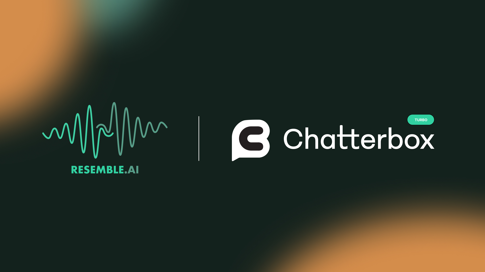

# Chatterbox TTS

[](https://resemble-ai.github.io/chatterbox_turbo_demopage/)
[](https://huggingface.co/spaces/ResembleAI/chatterbox-turbo-demo)
[](https://podonos.com/resembleai/chatterbox)
[](https://discord.gg/rJq9cRJBJ6)
[](LICENSE)
[](https://huggingface.co/ResembleAI)
[](https://github.com/resemble-ai/chatterbox)

_Desenvolvido com ê¢â„¢Â¥ê¯Â¸Â por <a href="https://resemble.ai" target="_blank"></a>_

---

## O que êƒÂ© o Chatterbox?

**Chatterbox** êƒÂ© uma famêƒÂ­lia de trêƒÂªs modelos de sêƒÂ­ntese de voz (TTS) de cêƒÂ³digo aberto, estado da arte, desenvolvidos pela **Resemble AI**. LanêƒÂ§ado sob licenêƒÂ§a **MIT** (uso comercial livre), o Chatterbox ultrapassou **1 milhêƒÂ£o de downloads** no HuggingFace e superou soluêƒÂ§êƒÂµes comerciais como ElevenLabs em testes cegos ê¢â‚¬â€ com **63,75% de preferêƒÂªncia dos usuêƒÂ¡rios**.

### HistêƒÂ³rico de LanêƒÂ§amentos

| Data | Evento |
|------|--------|
| **Maio 2025** | LanêƒÂ§amento do **Chatterbox** original (500M, inglêƒÂªs, MIT) ê¢â‚¬â€ primeiro TTS open-source com controle de exageraêƒÂ§êƒÂ£o emocional. Atingiu 11.000+ estrelas no GitHub em poucas semanas |
| **Setembro 2025** | LanêƒÂ§amento do **Chatterbox-Multilingual** (500M, 23 idiomas) |
| **Dezembro 2025** | LanêƒÂ§amento do **Chatterbox-Turbo** (350M, inglêƒÂªs) ê¢â‚¬â€ avaliaêƒÂ§êƒÂ£o Podonos publicada em 12/12/2025. Superou ElevenLabs em 63,75% de preferêƒÂªncia |

### Por que escolher o Chatterbox?

| CritêƒÂ©rio | Chatterbox | ElevenLabs / Cartesia |
|----------|-----------|----------------------|
| LicenêƒÂ§a | **MIT (gratuito e comercial)** | ProprietêƒÂ¡rio (pago) |
| Voice Clone | **Zero-shot, sem treinamento** | Requer conta paga |
| Qualidade | **Avaliado superior em testes cegos** | ReferêƒÂªncia de mercado |
| Self-hosted | **Sim, 100% offline** | NêƒÂ£o |
| Watermark IA | **Sim (Perth, imperceptêƒÂ­vel)** | NêƒÂ£o |
| Idiomas | **23 idiomas (modelo MTL)** | Varia por plano |

---

## FamêƒÂ­lia de Modelos


### ê¢Å¡Â¡ Comparativo dos Modelos

| Modelo | ParêƒÂ¢metros | Idiomas | Destaques | Melhor Para | Demo | Exemplos |
|:-------|:----------:|:-------:|:----------|:------------|:----:|:--------:|
| **Chatterbox-Turbo** | **350M** | **InglêƒÂªs** | Tags paralingêƒÂ¼êƒÂ­sticas, 1-step decoder, menor VRAM | Voice agents em tempo real, produêƒÂ§êƒÂ£o | [Demo](https://huggingface.co/spaces/ResembleAI/chatterbox-turbo-demo) | [Ouvir](https://resemble-ai.github.io/chatterbox_turbo_demopage/) |
| **Chatterbox-Multilingual** | 500M | **23 idiomas** | Zero-shot cloning cross-language, backbone Llama | LocalizaêƒÂ§êƒÂ£o, dublagem, aplicaêƒÂ§êƒÂµes globais | [Demo](https://huggingface.co/spaces/ResembleAI/Chatterbox-Multilingual-TTS) | [Ouvir](https://resemble-ai.github.io/chatterbox_demopage/) |
| **Chatterbox** (English) | 500M | InglêƒÂªs | Controles CFG e Exaggeration, backbone Llama | TTS criativo, controle expressivo fino | [Demo](https://huggingface.co/spaces/ResembleAI/Chatterbox) | [Ouvir](https://resemble-ai.github.io/chatterbox_demopage/) |

---

## Arquitetura TêƒÂ©cnica

O pipeline segue dois estêƒÂ¡gios principais:

```
Texto + Embedding de Voz (256-dim)
         ê¢â€â€š
         ê¢â€“¼
ê¢â€Å’ê¢â€â‚¬ê¢â€â‚¬ê¢â€â‚¬ê¢â€â‚¬ê¢â€â‚¬ê¢â€â‚¬ê¢â€â‚¬ê¢â€â‚¬ê¢â€â‚¬ê¢â€â‚¬ê¢â€â‚¬ê¢â€â‚¬ê¢â€â‚¬ê¢â€â‚¬ê¢â€â‚¬ê¢â€â‚¬ê¢â€â‚¬ê¢â€â‚¬ê¢â€â‚¬ê¢â€â‚¬ê¢â€â‚¬ê¢â€Â
ê¢â€â€š   T3 (LLM)          ê¢â€â€š  GPT2 (Turbo) ou Llama (English/MTL)
ê¢â€â€š   Texto ê¢â€ â€™ Tokens    ê¢â€â€š  VocabulêƒÂ¡rio: 704 (EN) / 2454 (MTL)
ê¢â€â€š   de Fala @ 25 Hz   ê¢â€â€š
ê¢â€â€ê¢â€â‚¬ê¢â€â‚¬ê¢â€â‚¬ê¢â€â‚¬ê¢â€â‚¬ê¢â€â‚¬ê¢â€â‚¬ê¢â€â‚¬ê¢â€â‚¬ê¢â€â‚¬ê¢â€â‚¬ê¢â€â‚¬ê¢â€â‚¬ê¢â€â‚¬ê¢â€â‚¬ê¢â€â‚¬ê¢â€â‚¬ê¢â€â‚¬ê¢â€â‚¬ê¢â€â‚¬ê¢â€â‚¬ê¢â€Ëœ
         ê¢â€â€š
         ê¢â€“¼
ê¢â€Å’ê¢â€â‚¬ê¢â€â‚¬ê¢â€â‚¬ê¢â€â‚¬ê¢â€â‚¬ê¢â€â‚¬ê¢â€â‚¬ê¢â€â‚¬ê¢â€â‚¬ê¢â€â‚¬ê¢â€â‚¬ê¢â€â‚¬ê¢â€â‚¬ê¢â€â‚¬ê¢â€â‚¬ê¢â€â‚¬ê¢â€â‚¬ê¢â€â‚¬ê¢â€â‚¬ê¢â€â‚¬ê¢â€â‚¬ê¢â€Â
ê¢â€â€š   S3Gen (CFM)        ê¢â€â€š  Flow Matching (Diffusion)
ê¢â€â€š   Tokens ê¢â€ â€™ Mel       ê¢â€â€š  1 step (Turbo) ou 10 steps (outros)
ê¢â€â€š   Spectrograma       ê¢â€â€š  Entrada: S3_SR = 16.000 Hz
ê¢â€â€ê¢â€â‚¬ê¢â€â‚¬ê¢â€â‚¬ê¢â€â‚¬ê¢â€â‚¬ê¢â€â‚¬ê¢â€â‚¬ê¢â€â‚¬ê¢â€â‚¬ê¢â€â‚¬ê¢â€â‚¬ê¢â€â‚¬ê¢â€â‚¬ê¢â€â‚¬ê¢â€â‚¬ê¢â€â‚¬ê¢â€â‚¬ê¢â€â‚¬ê¢â€â‚¬ê¢â€â‚¬ê¢â€â‚¬ê¢â€Ëœ
         ê¢â€â€š
         ê¢â€“¼
ê¢â€Å’ê¢â€â‚¬ê¢â€â‚¬ê¢â€â‚¬ê¢â€â‚¬ê¢â€â‚¬ê¢â€â‚¬ê¢â€â‚¬ê¢â€â‚¬ê¢â€â‚¬ê¢â€â‚¬ê¢â€â‚¬ê¢â€â‚¬ê¢â€â‚¬ê¢â€â‚¬ê¢â€â‚¬ê¢â€â‚¬ê¢â€â‚¬ê¢â€â‚¬ê¢â€â‚¬ê¢â€â‚¬ê¢â€â‚¬ê¢â€Â
ê¢â€â€š   HiFiGAN Vocoder   ê¢â€â€š  Mel ê¢â€ â€™ êƒÂudio WAV
ê¢â€â€š   SaêƒÂ­da @ 24 kHz    ê¢â€â€š  S3GEN_SR = 24.000 Hz
ê¢â€â€ê¢â€â‚¬ê¢â€â‚¬ê¢â€â‚¬ê¢â€â‚¬ê¢â€â‚¬ê¢â€â‚¬ê¢â€â‚¬ê¢â€â‚¬ê¢â€â‚¬ê¢â€â‚¬ê¢â€â‚¬ê¢â€â‚¬ê¢â€â‚¬ê¢â€â‚¬ê¢â€â‚¬ê¢â€â‚¬ê¢â€â‚¬ê¢â€â‚¬ê¢â€â‚¬ê¢â€â‚¬ê¢â€â‚¬ê¢â€Ëœ
         ê¢â€â€š
         ê¢â€“¼
ê¢â€Å’ê¢â€â‚¬ê¢â€â‚¬ê¢â€â‚¬ê¢â€â‚¬ê¢â€â‚¬ê¢â€â‚¬ê¢â€â‚¬ê¢â€â‚¬ê¢â€â‚¬ê¢â€â‚¬ê¢â€â‚¬ê¢â€â‚¬ê¢â€â‚¬ê¢â€â‚¬ê¢â€â‚¬ê¢â€â‚¬ê¢â€â‚¬ê¢â€â‚¬ê¢â€â‚¬ê¢â€â‚¬ê¢â€â‚¬ê¢â€Â
ê¢â€â€š   Perth Watermark   ê¢â€â€š  Marca d'êƒÂ¡gua neural imperceptêƒÂ­vel
ê¢â€â€ê¢â€â‚¬ê¢â€â‚¬ê¢â€â‚¬ê¢â€â‚¬ê¢â€â‚¬ê¢â€â‚¬ê¢â€â‚¬ê¢â€â‚¬ê¢â€â‚¬ê¢â€â‚¬ê¢â€â‚¬ê¢â€â‚¬ê¢â€â‚¬ê¢â€â‚¬ê¢â€â‚¬ê¢â€â‚¬ê¢â€â‚¬ê¢â€â‚¬ê¢â€â‚¬ê¢â€â‚¬ê¢â€â‚¬ê¢â€Ëœ
```

### Detalhes por Componente

**T3 ê¢â‚¬â€ Text-to-Speech-Token:**
- Backbone: GPT2 (Turbo / 350M) ou Llama (English & MTL / 500M)
- Taxa de saêƒÂ­da: 25 Hz de tokens de fala
- Condicionado por: tokens de texto + embedding de locutor (256 dims)
- Treinado em: **500.000 horas de êƒÂ¡udio limpo**
- VocabulêƒÂ¡rio: 704 tokens (inglêƒÂªs) / 2.454 tokens (multilingual)

**S3Gen ê¢â‚¬â€ Token-to-Audio:**
- Decoder: `CausalMaskedDiffWithXvec` (Flow Matching)
- Turbo: **1 passo** ê¢â‚¬â€ viabiliza latêƒÂªncia ultra-baixa
- English/MTL: 10 passos ê¢â‚¬â€ maior qualidade/expressividade
- Vocoder final: HiFTGenerator ê¢â€ â€™ 24 kHz

**VoiceEncoder:**
- Extrai embeddings de 256 dimensêƒÂµes do êƒÂ¡udio de referêƒÂªncia
- Condiciona tanto T3 quanto S3Gen
- ReferêƒÂªncia processada a 16 kHz (S3_SR)

---

## InstalaêƒÂ§êƒÂ£o

### Via pip (recomendado)

```bash
pip install chatterbox-tts
```

### A partir do cêƒÂ³digo-fonte (para desenvolvimento)

```bash
# Criar ambiente isolado (Python 3.11 recomendado)
conda create -yn chatterbox python=3.11
conda activate chatterbox

git clone https://github.com/resemble-ai/chatterbox.git
cd chatterbox
pip install -e .
```

> **Nota:** As dependêƒÂªncias estêƒÂ£o fixadas no `pyproject.toml` para garantir consistêƒÂªncia. Desenvolvido e testado em Python 3.11 no Debian 11.

### InstalaêƒÂ§êƒÂ£o em hardware Blackwell / CUDA 13.0 (GB10, RTX 50xx)

Para GPUs com compute capability ê¢â€°Â¥ 12.0 (Blackwell) usando CUDA 13.0:

```bash
conda create -yn chatterbox python=3.11
conda activate chatterbox

# torch com suporte CUDA 13.0 para ARM64/x86
pip install torch==2.10.0+cu130 torchaudio==2.10.0+cu130 \
    --index-url https://download.pytorch.org/whl/cu130

# Chatterbox sem sobrescrever torch
pip install -e . --no-deps

# DependêƒÂªncias crêƒÂ­ticas (versêƒÂµes obrigatêƒÂ³rias)
pip install transformers==4.46.3 safetensors==0.5.3 \
    diffusers==0.29.0 "numpy>=1.24.0,<1.26.0" \
    soundfile s3tokenizer resemble-perth
```

> **Aviso esperado:** PyTorch 2.10 reporta `UserWarning` sobre compute capability 12.1 vs mêƒÂ¡ximo suportado 12.0. Apenas informativo ê¢â‚¬â€ CUDA funciona normalmente.

---

## Uso

### Chatterbox-Turbo (InglêƒÂªs, Alta Velocidade)

```python
import soundfile as sf
import torch
from chatterbox.tts_turbo import ChatterboxTurboTTS

# Carregar modelo
model = ChatterboxTurboTTS.from_pretrained(device="cuda")

# GeraêƒÂ§êƒÂ£o simples (voz padrêƒÂ£o)
text = "Hello! Welcome to Chatterbox TTS, the fastest open-source voice synthesis."
wav = model.generate(text)

# Com tags paralingêƒÂ¼êƒÂ­sticas
text_expressivo = (
    "Hi there! [chuckle] Great to hear from you. "
    "Let me check that for you [cough] ê¢â‚¬â€ just one moment!"
)
wav = model.generate(text_expressivo)

# Com clonagem de voz (arquivo de referêƒÂªncia ~10s, mono, 24 kHz)
wav = model.generate(text, audio_prompt_path="sua_voz_referencia.wav")

# Salvar êƒÂ¡udio
audio_np = wav.squeeze().cpu().numpy()
sf.write("saida.wav", audio_np, model.sr)  # sr = 24000
```

### Chatterbox English (500M, Controle Expressivo)

```python
import soundfile as sf
import torch
from chatterbox.tts import ChatterboxTTS

model = ChatterboxTTS.from_pretrained(device="cuda")

text = "This is a test of the Chatterbox English model with expressive controls."

# ParêƒÂ¢metros de expressividade
# exaggeration: 0.0 (neutro) ê¢â€ â€™ 1.0 (muito expressivo), padrêƒÂ£o 0.5
# cfg_weight: controla aderêƒÂªncia êƒÂ  voz de referêƒÂªncia, padrêƒÂ£o 0.5
wav = model.generate(text, exaggeration=0.7, cfg_weight=0.3)

# Com voz clonada
wav = model.generate(text, audio_prompt_path="referencia.wav", exaggeration=0.5)

audio_np = wav.squeeze().cpu().numpy()
sf.write("saida_en.wav", audio_np, model.sr)
```

### Chatterbox-Multilingual (23 Idiomas)

```python
import soundfile as sf
import torch
from chatterbox.mtl_tts import ChatterboxMultilingualTTS

model = ChatterboxMultilingualTTS.from_pretrained(device="cuda")

# PortuguêƒÂªs (PT)
texto_pt = "OlêƒÂ¡! Este êƒÂ© um teste do modelo Chatterbox Multilingual em portuguêƒÂªs."
wav = model.generate(texto_pt, language_id="pt")

# FrancêƒÂªs
texto_fr = "Bonjour! Voici un exemple en franêƒÂ§ais avec le modêƒÂ¨le multilingue."
wav_fr = model.generate(texto_fr, language_id="fr")

# Espanhol com clone de voz cross-language
texto_es = "Hola! Este es un ejemplo de clonaciêƒÂ³n de voz entre idiomas."
wav_clone = model.generate(
    texto_es,
    language_id="es",
    audio_prompt_path="referencia_pt.wav"  # voz em PT, fala em ES
)

# Salvar
audio_np = wav.squeeze().cpu().numpy()
sf.write("saida_pt.wav", audio_np, model.sr)
```

---

## Tags ParalingêƒÂ¼êƒÂ­sticas (Turbo)

O modelo Turbo suporta inserêƒÂ§êƒÂ£o nativa de eventos de fala naturais diretamente no texto:

| Tag | Efeito |
|-----|--------|
| `[chuckle]` | Riso suave / risada leve |
| `[laugh]` | Gargalhada |
| `[cough]` | Tosse |
| `[sigh]` | Suspiro |
| `[gasp]` | Ofego / surpresa |

**Exemplo:**
```python
text = (
    "Sarah here from support [chuckle], how can I help you today? "
    "[cough] Sorry about that ê¢â‚¬â€ let me pull up your account."
)
wav = model.generate(text, audio_prompt_path="agente_voz.wav")
```

---

## Idiomas Suportados (Multilingual)

êƒÂrabe (ar) ê¢â‚¬Â¢ DinamarquêƒÂªs (da) ê¢â‚¬Â¢ AlemêƒÂ£o (de) ê¢â‚¬Â¢ Grego (el) ê¢â‚¬Â¢ **InglêƒÂªs (en)** ê¢â‚¬Â¢ **Espanhol (es)** ê¢â‚¬Â¢ FinlandêƒÂªs (fi) ê¢â‚¬Â¢ **FrancêƒÂªs (fr)** ê¢â‚¬Â¢ Hebraico (he) ê¢â‚¬Â¢ Hindi (hi) ê¢â‚¬Â¢ Italiano (it) ê¢â‚¬Â¢ JaponêƒÂªs (ja) ê¢â‚¬Â¢ Coreano (ko) ê¢â‚¬Â¢ Malaio (ms) ê¢â‚¬Â¢ HolandêƒÂªs (nl) ê¢â‚¬Â¢ NorueguêƒÂªs (no) ê¢â‚¬Â¢ PolonêƒÂªs (pl) ê¢â‚¬Â¢ **PortuguêƒÂªs (pt)** ê¢â‚¬Â¢ Russo (ru) ê¢â‚¬Â¢ Sueco (sv) ê¢â‚¬Â¢ SuaêƒÂ­li (sw) ê¢â‚¬Â¢ Turco (tr) ê¢â‚¬Â¢ ChinêƒÂªs (zh)

> 23 idiomas no total. Clone de voz cross-language suportado: forneêƒÂ§a referêƒÂªncia em um idioma e gere em outro.

---

## Clonagem de Voz Zero-Shot

### Como funciona

1. ForneêƒÂ§a um êƒÂ¡udio de referêƒÂªncia (mêƒÂ­nimo **5 segundos**, ideal **10+ segundos**)
2. O `VoiceEncoder` extrai embedding de 256 dimensêƒÂµes da voz
3. T3 e S3Gen sêƒÂ£o condicionados pelo embedding ê¢â‚¬â€ **nenhum treinamento necessêƒÂ¡rio**
4. A voz clonada êƒÂ© gerada em qualquer idioma suportado

### Requisitos do êƒÂ¡udio de referêƒÂªncia

| ParêƒÂ¢metro | Recomendado |
|-----------|-------------|
| DuraêƒÂ§êƒÂ£o | 10s+ (mêƒÂ­nimo 5s para Turbo) |
| Formato | WAV, mono |
| Sample rate | 16ê¢â‚¬â€œ24 kHz |
| Qualidade | Sem ruêƒÂ­do de fundo, voz clara |
| ConteêƒÂºdo | Fala contêƒÂ­nua, sem mêƒÂºsica |

### Extraindo referêƒÂªncia de um vêƒÂ­deo

```bash
# Extrair êƒÂ¡udio de um MP4 (10 segundos, pular os 2 primeiros)
ffmpeg -i video.mp4 -vn -ac 1 -ar 24000 \
       -ss 2 -t 10 -c:a pcm_s16le referencia.wav
```

---

## ParêƒÂ¢metros de Controle (English / Multilingual)

| ParêƒÂ¢metro | PadrêƒÂ£o | DescriêƒÂ§êƒÂ£o |
|-----------|--------|-----------|
| `exaggeration` | `0.5` | Intensidade expressiva. `0.7+` para fala dramêƒÂ¡tica |
| `cfg_weight` | `0.5` | AderêƒÂªncia êƒÂ  voz de referêƒÂªncia. `0.3` melhora ritmo para locutores rêƒÂ¡pidos |
| `audio_prompt_path` | `None` | Caminho para arquivo WAV de referêƒÂªncia de voz |
| `language_id` | ê¢â‚¬â€  | CêƒÂ³digo do idioma (apenas Multilingual) ex: `"pt"`, `"en"`, `"fr"` |

**Dicas:**
- Para fala neutra e consistente: `exaggeration=0.5, cfg_weight=0.5`
- Para fala expressiva/dramêƒÂ¡tica: `exaggeration=0.7, cfg_weight=0.3`
- Se referêƒÂªncia tem ritmo rêƒÂ¡pido: reduza `cfg_weight` para ~0.3

---

## Performance e Requisitos de Hardware

### Real-Time Factor (RTF) ê¢â‚¬â€ Benchmark Oficial

| Plataforma | RTF | Contexto |
|-----------|:---:|----------|
| RTX 4090 (streaming) | **0,499** | Gera 2êƒâ€” mais rêƒÂ¡pido que o tempo real |
| ServiêƒÂ§o comercial Resemble AI | ê¢â‚¬â€ | LatêƒÂªncia ao primeiro chunk **<200ms** |
| ImplementaêƒÂ§êƒÂ£o streaming (open-source) | ê¢â‚¬â€ | ~472ms ao primeiro chunk |

> RTF < 1.0 = geraêƒÂ§êƒÂ£o em tempo real. RTF 0,499 = produz 2 segundos de êƒÂ¡udio para cada 1 segundo de processamento.

### LatêƒÂªncia medida (GB10 Blackwell, 128 GB VRAM unificada)

| Modelo | Carregamento | GeraêƒÂ§êƒÂ£o têƒÂ­pica | êƒÂudio gerado |
|--------|:------------:|:--------------:|:------------:|
| Turbo | 1.262s (cache) | **~2.7s** | ~7s de fala |
| Turbo (com clone) | ê¢â‚¬â€ | ~2.9s | ~7s de fala |
| Multilingual | 749.8s (1ꂪ vez) | **~4.4s** (PT) | ~6.7s de fala |
| English (500M) | ~similar MTL | ~3-5s | ~6-8s de fala |

> Primeira execuêƒÂ§êƒÂ£o faz download dos modelos (~21 min para Turbo, ~similar para os 500M). ExecuêƒÂ§êƒÂµes subsequentes usam cache local.

### Requisitos de VRAM

| Uso | VRAM MêƒÂ­nima | Recomendado |
|-----|:-----------:|:-----------:|
| Turbo (350M) | **4ê¢â‚¬â€œ6 GB** | 8 GB |
| English/MTL (500M) | **8ê¢â‚¬â€œ12 GB** | 16 GB |
| ProduêƒÂ§êƒÂ£o (alta concorrêƒÂªncia) | 16ê¢â‚¬â€œ24 GB | 32 GB+ |

### Plataformas suportadas
- **NVIDIA CUDA** (recomendado) ê¢â‚¬â€ RTX 3060+ / A4000+ / GB10
- **Apple MPS** (M1/M2/M3)
- **CPU** (funcional, mas lento)
- **AMD ROCm** (via builds compatêƒÂ­veis)

---

## Perth Watermarking ê¢â‚¬â€ IA ResponsêƒÂ¡vel

Todo êƒÂ¡udio gerado pelo Chatterbox inclui automaticamente a **marca d'êƒÂ¡gua neural Perth** da Resemble AI ê¢â‚¬â€ imperceptêƒÂ­vel ao ouvido humano, mas detectêƒÂ¡vel por mêƒÂ¡quina.

### CaracterêƒÂ­sticas
- Sobrevive a compressêƒÂ£o MP3 e ediêƒÂ§êƒÂ£o de êƒÂ¡udio, reamostragem, re-encoding, adiêƒÂ§êƒÂ£o de ruêƒÂ­do e time-stretching
- PrecisêƒÂ£o de detecêƒÂ§êƒÂ£o prêƒÂ³xima a 100%
- Dados codificados em regiêƒÂµes inaudêƒÂ­veis do espectro (mascaramento auditivo)
- Atende requisitos de regulaêƒÂ§êƒÂ£o de conteêƒÂºdo IA
- DisponêƒÂ­vel como ferramenta independente: [github.com/resemble-ai/perth](https://github.com/resemble-ai/perth)

> O CEO da Resemble AI, Zohaib Ahmed, prestou testemunho ao **Senado dos EUA** sobre a importêƒÂ¢ncia de watermarking em êƒÂ¡udio sintêƒÂ©tico gerado por IA.

### Verificar marca d'êƒÂ¡gua

```python
import perth
import librosa

audio, sr = librosa.load("audio_gerado.wav", sr=None)
watermarker = perth.PerthImplicitWatermarker()
watermark = watermarker.get_watermark(audio, sample_rate=sr)
print(f"Marca d'êƒÂ¡gua: {watermark}")  # 0.0 = sem marca, 1.0 = marcado
```

---

## AvaliaêƒÂ§êƒÂµes de Qualidade

O Chatterbox Turbo foi avaliado via **Podonos** ê¢â‚¬â€ plataforma de avaliaêƒÂ§êƒÂ£o subjetiva reproduzêƒÂ­vel de fala ê¢â‚¬â€ em comparaêƒÂ§êƒÂµes diretas:

| ComparaêƒÂ§êƒÂ£o | Resultado |
|-----------|-----------|
| Chatterbox Turbo vs **ElevenLabs Turbo v2.5** | [Ver relatêƒÂ³rio](https://podonos.com/resembleai/chatterbox-turbo-vs-elevenlabs-turbo) |
| Chatterbox Turbo vs **Cartesia Sonic 3** | [Ver relatêƒÂ³rio](https://podonos.com/resembleai/chatterbox-turbo-vs-cartesia-sonic3) |
| Chatterbox Turbo vs **VibeVoice 7B** | [Ver relatêƒÂ³rio](https://podonos.com/resembleai/chatterbox-turbo-vs-vibevoice7b) |

> **63,75% dos usuêƒÂ¡rios preferiram Chatterbox** ao ElevenLabs em testes cegos independentes.

---

## Casos de Uso

| êƒÂrea | AplicaêƒÂ§êƒÂ£o |
|------|-----------|
| **Voice Agents** | Atendimento ao cliente, assistentes virtuais, IVR |
| **Dublagem** | LocalizaêƒÂ§êƒÂ£o de conteêƒÂºdo audiovisual em mêƒÂºltiplos idiomas |
| **NarraêƒÂ§êƒÂ£o** | Audiobooks, podcasts, e-learning |
| **Games & NPCs** | Vozes procedurais com personalidade |
| **Acessibilidade** | Leitores de tela expressivos, TTS para deficientes visuais |
| **CriaêƒÂ§êƒÂ£o de ConteêƒÂºdo** | VêƒÂ­deos com narraêƒÂ§êƒÂ£o automêƒÂ¡tica em voz clonada |
| **Agentes de IA** | LLMs com saêƒÂ­da de voz em tempo real (sub-150ms) |

---

## ImplantaêƒÂ§êƒÂ£o e IntegraêƒÂ§êƒÂµes

### Plataformas de Hospedagem
- [HuggingFace Spaces](https://huggingface.co/spaces/ResembleAI/chatterbox-turbo-demo)
- [RunPod](https://runpod.io)
- [Modal](https://modal.com)
- [Replicate](https://replicate.com)
- [Fal](https://fal.ai)

### Self-Hosted com API REST
```bash
# Usando devnen/Chatterbox-TTS-Server
# API compatêƒÂ­vel com OpenAI, Web UI, processamento de audiobooks
git clone https://github.com/devnen/Chatterbox-TTS-Server
```

### VLLM Port (alta throughput)
```bash
# randombk/chatterbox-vllm
git clone https://github.com/randombk/chatterbox-vllm
```

### VersêƒÂ£o ONNX (cross-platform, sem PyTorch)

O Turbo possui versêƒÂ£o ONNX no HuggingFace, adequada para deployment em hardware sem CUDA:

```bash
# Modelo ONNX: ResembleAI/chatterbox-turbo-ONNX
# Suporta NVIDIA (CUDA), AMD (ROCm) e CPU
```

---

## Estrutura do RepositêƒÂ³rio

```
chatterbox/
ê¢â€Å“ê¢â€â‚¬ê¢â€â‚¬ src/chatterbox/
ê¢â€â€š   ê¢â€Å“ê¢â€â‚¬ê¢â€â‚¬ tts.py              # ChatterboxTTS (English 500M)
ê¢â€â€š   ê¢â€Å“ê¢â€â‚¬ê¢â€â‚¬ tts_turbo.py        # ChatterboxTurboTTS (350M)
ê¢â€â€š   ê¢â€Å“ê¢â€â‚¬ê¢â€â‚¬ mtl_tts.py          # ChatterboxMultilingualTTS (500M)
ê¢â€â€š   ê¢â€Å“ê¢â€â‚¬ê¢â€â‚¬ models/
ê¢â€â€š   ê¢â€â€š   ê¢â€Å“ê¢â€â‚¬ê¢â€â‚¬ t3/             # Modelo T3 (LLM: GPT2 / Llama)
ê¢â€â€š   ê¢â€â€š   ê¢â€Å“ê¢â€â‚¬ê¢â€â‚¬ s3gen/          # Decoder CFM + HiFiGAN
ê¢â€â€š   ê¢â€â€š   ê¢â€â€ê¢â€â‚¬ê¢â€â‚¬ voice_encoder/  # VoiceEncoder (embeddings 256-dim)
ê¢â€â€š   ê¢â€â€ê¢â€â‚¬ê¢â€â‚¬ data/               # Processamento de êƒÂ¡udio e texto
ê¢â€Å“ê¢â€â‚¬ê¢â€â‚¬ example_tts.py          # Exemplos de uso TTS
ê¢â€Å“ê¢â€â‚¬ê¢â€â‚¬ example_vc.py           # Exemplos de voice clone
ê¢â€Å“ê¢â€â‚¬ê¢â€â‚¬ pyproject.toml          # DependêƒÂªncias fixadas
ê¢â€â€ê¢â€â‚¬ê¢â€â‚¬ README.md               # Este arquivo
```

### RepositêƒÂ³rios HuggingFace

| Modelo | RepositêƒÂ³rio HF |
|--------|---------------|
| Turbo (350M) | `ResembleAI/chatterbox-turbo` |
| English (500M) | `ResembleAI/chatterbox` |
| Multilingual (500M) | `ResembleAI/chatterbox-multilingual` |

---

## Comunidade

- **Discord:** [Entrar no servidor](https://discord.gg/rJq9cRJBJ6)
- **Issues:** [GitHub Issues](https://github.com/resemble-ai/chatterbox/issues)
- **Demos ao vivo:** [Turbo](https://resemble-ai.github.io/chatterbox_turbo_demopage/) | [Multilingual](https://resemble-ai.github.io/chatterbox_demopage/)

---

## Agradecimentos

- [Podonos](https://podonos.com) ê¢â‚¬â€ avaliaêƒÂ§êƒÂ£o subjetiva de fala reproduzêƒÂ­vel
- [Cosyvoice](https://github.com/FunAudioLLM/CosyVoice)
- [Real-Time-Voice-Cloning](https://github.com/CorentinJ/Real-Time-Voice-Cloning)
- [HiFT-GAN](https://github.com/yl4579/HiFTNet)
- [Llama 3](https://github.com/meta-llama/llama3)
- [S3Tokenizer](https://github.com/xingchensong/S3Tokenizer)

---

## CitaêƒÂ§êƒÂ£o

Se vocêƒÂª usar este modelo em pesquisa, por favor cite:

```bibtex
@misc{chatterboxtts2025,
  author       = {{Resemble AI}},
  title        = {{Chatterbox-TTS}},
  year         = {2025},
  howpublished = {\url{https://github.com/resemble-ai/chatterbox}},
  note         = {GitHub repository}
}
```

---

## LicenêƒÂ§a e Aviso Legal

**LicenêƒÂ§a MIT** ê¢â‚¬â€ uso comercial e modificaêƒÂ§êƒÂ£o permitidos. Veja [LICENSE](LICENSE) para detalhes.

> Este modelo nêƒÂ£o deve ser utilizado para criaêƒÂ§êƒÂ£o de deepfakes, fraudes, personificaêƒÂ§êƒÂ£o nêƒÂ£o autorizada ou qualquer uso malicioso. Todo êƒÂ¡udio gerado contêƒÂ©m marca d'êƒÂ¡gua Perth para rastreabilidade. Os desenvolvedores nêƒÂ£o se responsabilizam por uso indevido.

---

Projeto adaptado da comunidade ARCKHê‰ TDS - ARCKHÉe